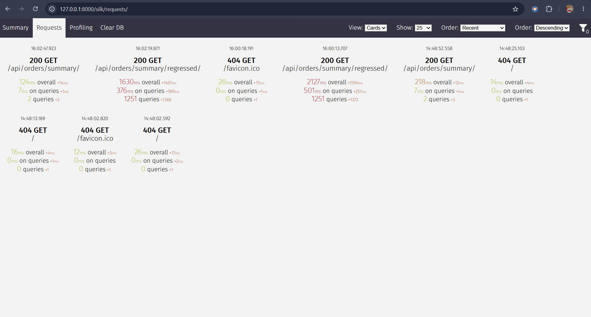
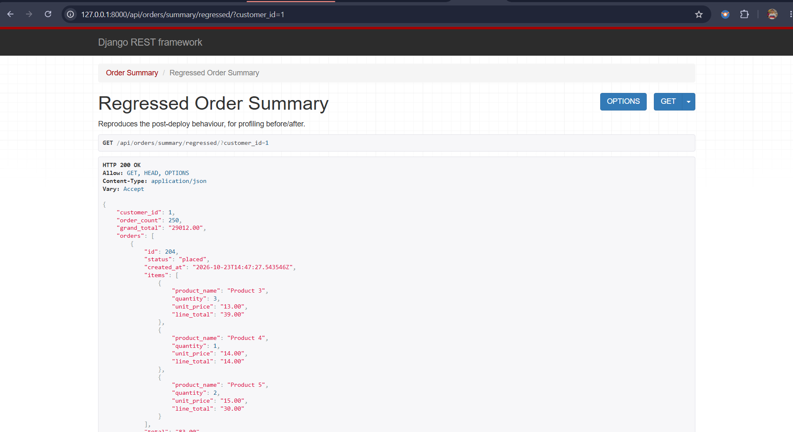
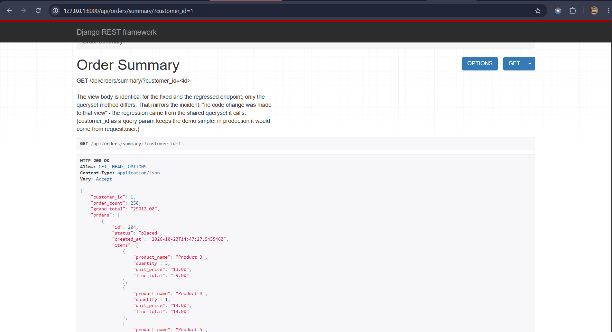

# ANSWERS

## Section 1 — Diagnose a Broken System

### Incident investigation log
1. **Checked request traces and DB logs for `/api/orders/summary/`**: First, I wanted to know if the 30s timeout was caused by a slow external call, table locks, or query volume. The logs showed no lock waits—just over a thousand fast, sequential `SELECT` queries firing per request until Gunicorn timed out.
2. **Compared fast vs. timing-out users**: Normal users (5–15 orders) still got ~80ms responses, while users with 200+ orders timed out. Since latency scaled linearly with order count, that pointed straight to an N+1 query in the response loop rather than a missing index on `orders_order`.
3. **Checked `git diff` on the last deploy**: The view in `orders/views.py` hadn't changed, so I checked what it calls: `OrderQuerySet.for_dashboard()` and `OrderSummarySerializer`. That showed the serializer was walking `order.items.all()` and `item.product.name` without eager loading on the queryset.
4. **Reproduced locally with `django-silk`**: I seeded a customer with 250 orders (3 items each) and hit the endpoint. Silk confirmed **1,251 queries** for one request.

### Root cause category and justification
**Category:** Multi-level **N+1 query regression** during DRF serialization.

For a user with 250 orders and 3 items per order (750 items total), `OrderSummarySerializer` triggers three layers of queries when `OrderQuerySet` doesn't prefetch relations:
- **1 query** to fetch the 250 `Order` rows.
- **500 queries** on `orders_orderitem`: `order.items.all()` is called twice per order—once by the nested `items = OrderItemSerializer(many=True)` field, and a second time inside `get_total()`. Without a prefetch cache, each `.all()` runs a fresh `SELECT ... WHERE order_id = ?`.
- **750 queries** on `orders_product`: `OrderItemSerializer` uses `source="product.name"`, which lazy-loads `item.product` once per line item.

That's `1 + 500 + 750 = 1,251` queries. On local SQLite this already costs ~510 ms of query time and 1.6–2.1 s per request in Silk at 250 orders. Against a networked Postgres, every one of those queries also pays a network round-trip, a connection-pool wait under load, and ORM object construction. Because the cost grows with order count, heavy users under production load cross the 30 s Gunicorn timeout.

### How the fix works at the ORM and database level
`OrderQuerySet.for_dashboard()` in `orders/models.py` collapses the 1,251 queries into **2 constant queries**:

```python
def for_dashboard(self):
    return self.select_related("customer").prefetch_related(
        Prefetch("items", queryset=OrderItem.objects.select_related("product"))
    )
```

1. **Query 1 (`Order` + `Customer`)**: `select_related("customer")` fetches the customer's orders and customer data in a single SQL `INNER JOIN`, using the composite index `order_customer_recent` on `(customer_id, -created_at)` so Postgres/SQLite doesn't need an extra sort step.
2. **Query 2 (`OrderItem` + `Product`)**: `prefetch_related` takes the 250 order IDs from Query 1 and runs one query: `SELECT ... FROM orders_orderitem INNER JOIN orders_product ... WHERE order_id IN (...)`. Django then attaches those items to `order._prefetched_objects_cache["items"]` in Python memory, with each item's `product` already cached via `select_related("product")`.
3. **Why `get_total()` sums in Python**: Both `OrderItemSerializer(many=True)` and `get_total()` iterate over `order.items.all()`, which reads directly from `_prefetched_objects_cache` without hitting the database. Using `order.items.aggregate(Sum(...))` here would bypass the prefetch cache and fire 250 extra queries.

### Profiler evidence (django-silk)
Measured on 250 orders × 3 items (`customer_id=1`) via `python manage.py profile_summary 1` and `django-silk` (`/silk/requests/`):

| | Queries | CLI Time (`profile_summary.txt`) | Silk Time (`docs/silk_requests_overview.png`) |
|---|---|---|---|
| **Before (regressed)** | 1,251 | 510.2 ms | 376–501 ms DB / 1,630–2,127 ms total |
| **After (fixed)** | 2 | 29.1 ms | 7 ms DB / 124–218 ms total |

Raw CLI output: [`docs/profile_summary.txt`](docs/profile_summary.txt)

**Silk request list (before and after):**



**Before: regressed endpoint, 1,251 queries**



**After: fixed endpoint, 2 queries**



### My interpretation of "no code change was made to that view"
`OrderSummaryView` in `orders/views.py` only wires `Order.objects.for_dashboard()` into `OrderSummarySerializer`. The view file itself never changed—the regression came from a change in the shared queryset or serializer it calls (e.g., someone added nested `items` and `product_name` to `OrderSummarySerializer` or removed `.prefetch_related()` from the manager method).

## Section 2 — Rate-Limited Async Job Queue

### What happens to in-flight tasks if the worker is SIGKILL'd, and how my implementation handles it
`SIGKILL` (`kill -9` or an OOM kill) terminates the worker process immediately at the OS level, skipping all Python `finally` blocks and Celery error hooks.

With Celery's defaults (`task_acks_late = False`, `worker_prefetch_multiplier = 4`), a worker prefetches 4 messages per slot and acknowledges them to Redis **before** running the task. If that worker is `SIGKILL`'d mid-task, the **running** job is lost, because its message was acked before execution started. Prefetched messages are not lost, since they were never acked, but they are delayed: Redis only redelivers them after `visibility_timeout` expires.

My setup in `config/settings.py` and `emailqueue/tasks.py` prevents lost jobs and makes duplicate sends rare:
1. **`CELERY_TASK_ACKS_LATE = True`**: The worker only acknowledges a message to Redis *after* `send_email` finishes (or after `self.retry()` schedules the next attempt).
2. **`CELERY_TASK_REJECT_ON_WORKER_LOST = True` + `visibility_timeout = 3600`**: If a worker child dies with `SIGKILL`, the parent process detects the killed PID and re-queues the unacked message right away. If the whole machine dies, Redis keeps the unacked message and redelivers it once the 1-hour `visibility_timeout` expires.
3. **`CELERY_WORKER_PREFETCH_MULTIPLIER = 1`**: Each worker process only checks out one task at a time instead of hoarding four in memory.
4. **Idempotent DB state (`EmailJob.status`)**: Late acks give at-least-once delivery, meaning a worker killed right *after* `provider.send()` succeeds—but *before* acking—will run again when redelivered. `enqueue_emails()` commits the `EmailJob` row first and dispatches tasks inside `transaction.on_commit()`. When `send_email` starts, it checks `if job.status != EmailJob.Status.QUEUED: return`, and on success it runs a conditional `EmailJob.objects.filter(pk=job_id, status=QUEUED).update(status=SENT)`. Any task redelivered after the DB row turns `SENT` exits immediately without sending a duplicate email. The one remaining gap, a kill between `provider.send()` and the `UPDATE`, is described in [DESIGN.md › Known limitations](DESIGN.md#known-limitations).

## Section 3 — Written Architecture Review

*Answered: Question A and Question C.*

### Question A — Django Admin Performance

On a 500,000-row table, a primary-key index rarely helps the Django admin changelist, because the slowdown usually comes from three places in `django.contrib.admin`.

**1. The `SELECT COUNT(*)` pagination queries.** By default, `ChangeList` runs `COUNT(*)` twice on every page load: once for the page links and once for the total record counter. In PostgreSQL, MVCC visibility rules force `COUNT(*)` to scan the table even when an index exists.
**Fix:** set `show_full_result_count = False` on the `ModelAdmin` to drop the extra unfiltered count. Then replace `ModelAdmin.paginator` with a custom `Paginator` subclass whose `count` property reads `pg_class.reltuples` for an instant approximate count when no filters are active.

**2. ForeignKey N+1 queries on the list page, and huge `<select>` dropdowns on the edit page.** Any related field in `list_display` fires one query per row (100 extra queries per page). Opening the detail view renders every `ForeignKey` as a `<select>` widget that pulls hundreds of thousands of related rows into the HTML.
**Fix:** set `list_select_related = ("customer",)` on the `ModelAdmin` so Django fetches related rows in a single `JOIN`. Add `autocomplete_fields = ("customer",)` (or `raw_id_fields`) so the form loads options through paginated AJAX.

**3. `search_fields`.** `search_fields = ["email"]` generates `UPPER(email::text) LIKE UPPER('%term%')`. Because of the leading `%` wildcard, Postgres cannot use a B-tree index and runs a full sequential scan.
**Fix:** prefix fields with `^` or `=` (`search_fields = ["^email", "=reference"]`) and add a matching functional index, e.g. `Index(Upper("email"), name="email_upper_idx")` (with `text_pattern_ops` for prefix `LIKE`). A plain index on `email` is not used for an `UPPER()` lookup. For true substring search, add a `GinIndex` with `gin_trgm_ops` instead.

**Trade-off:** I give up exact total row counts and mid-string search on unindexed fields in exchange for fast page loads.

### Question C — File Upload Security

When auditing a Django file-upload endpoint at the application layer, I focus on five attack vectors:

**1. Path traversal and filename collisions.** Trusting `UploadedFile.name` can overwrite existing files or write outside the target folder. Django's `Storage.get_valid_name()` already strips `..` segments, but I go further: I pass a callable to `models.FileField(upload_to=...)` that discards the user's filename entirely and generates a fresh `uuid.uuid4().hex` name with a validated extension. The original name is stored only in a database `CharField`.

**2. MIME-type and extension spoofing.** Attackers rename a malicious `.html` or `.exe` to `.png` and spoof the `Content-Type` header (`UploadedFile.content_type`). I combine `django.core.validators.FileExtensionValidator` with a custom form/serializer `clean()` validator that reads the first 2,048 bytes (`file.read(2048)`) through `python-magic` to verify the real magic bytes. For images I also rely on Pillow's `Image.verify()` (via `models.ImageField`) to reject malformed payloads.

**3. Memory exhaustion and DoS.** Huge uploads or decompression bombs can exhaust worker RAM. `FILE_UPLOAD_MAX_MEMORY_SIZE` (2621440, i.e. 2.5 MB) makes larger files spill to disk as a `TemporaryUploadedFile` instead of RAM. `DATA_UPLOAD_MAX_MEMORY_SIZE` caps the non-file request body. Django has no built-in maximum file size, so I add a validator that rejects `UploadedFile.size` above a limit. I also set Pillow's `Image.MAX_IMAGE_PIXELS` to block pixel-flood bombs, and process large files only through `UploadedFile.chunks()`.

**4. Stored XSS via active content (SVG/HTML).** An uploaded `.svg` can contain inline `<script>` tags that run in the user's origin if opened directly. I disallow `.svg` and `.html` in `FileExtensionValidator` for untrusted users, and serve downloads through a Django view returning `FileResponse(..., as_attachment=True)` (`Content-Disposition: attachment`), with `SECURE_CONTENT_TYPE_NOSNIFF = True` (`X-Content-Type-Options: nosniff`).

**5. Execution from `MEDIA_ROOT`.** To prevent uploaded scripts from being imported or executed, I keep `MEDIA_ROOT` outside the project's Python package tree and never route `MEDIA_URL` through the WSGI application in production.

**Trade-off:** strict magic-byte checks and `as_attachment=True` cost slightly more CPU per upload and lose inline browser previews for some document types.
